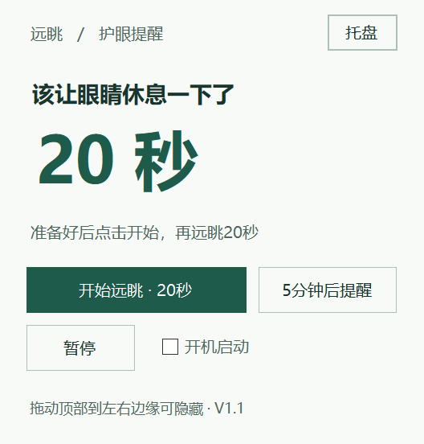

<div align="center">
  <h1>远眺 · Windows 护眼提醒</h1>
  <p><strong>定时休息、自定义时长，轻量常驻桌面。</strong></p>
  <p>  <a href="https://github.com/hcycyxx/EyeRest/stargazers"></a></p>
</div>

轻量 Windows 桌面小工具：定时弹出悬浮窗，提醒看约6米外；休息倒计时由你点击开始。支持自定义提醒间隔、休息秒数、左右贴边隐藏和开机启动。

## 下载

当前版本：**V1.3**。

- **[下载可直接运行的 EXE](https://github.com/hcycyxx/EyeRest/releases/download/v1.3.0/EyeRest_v1_3.exe)**
- **[下载完整包：程序、源码和说明](https://github.com/hcycyxx/EyeRest/releases/download/v1.3.0/EyeRest_v1_3_bundle.zip)**
- [下载新增源码文档快照（含 V1.3 EXE）](https://github.com/hcycyxx/EyeRest/releases/download/v1.3.0/EyeRest-v1.3-source-docs-20261109_v2.zip)
- [查看版本下载页](https://github.com/hcycyxx/EyeRest/releases/tag/v1.3.0)

EXE 也保留在仓库的 [outputs/EyeRest_v1_3](outputs/EyeRest_v1_3) 目录中；点击 EXE 文件后，使用 GitHub 文件页的下载按钮保存到电脑。

## 效果预览



以上为仓库已有的 **V1.1 历史截图**，不代表 V1.3 新增的绿色滚轮设置页。V1.3 截图待补；编译成功与实际运行验收分开记录。

## 安装与部署

这是 Windows 本地桌面程序，**不用部署网站或服务器**。

1. 使用 Windows 10 或 Windows 11，下载 EXE，或解压完整包。
2. 将 EXE 放在准备长期保留的文件夹，例如 `D:\Apps\EyeRest\`。
3. 如果旧版正在运行，先右键桌面右下角的远眺托盘图标 → **退出程序**。
4. 双击 `EyeRest_v1_3.exe`，即可开始计时。

无需安装 Python、Node.js 或浏览器组件。程序使用 Windows 的 .NET Framework；源码编译也使用系统中的 .NET Framework 编译器。运行和保存设置不需要管理员权限。

给另一台电脑使用时，复制 EXE 或完整压缩包即可。每个 Windows 账户分别保存自己的设置和启动项。

## 怎么使用

默认每 **20分钟** 提醒一次，点击“开始远眺”后倒计时 **20秒**。倒计时结束后开始下一轮。

| 操作 | 效果 |
| --- | --- |
| 时间设置 | 修改提醒间隔与休息秒数 |
| 立即休息 | 立即开始设定秒数的倒计时 |
| 5分钟后提醒 | 本次提醒延后5分钟，正常间隔设置不变 |
| 暂停 / 继续 | 暂停并恢复剩余工作时间 |
| 托盘 | 收起窗口；双击托盘图标重新展开 |
| 右键托盘 → 退出程序 | 完全退出；Alt+F4只收起到托盘 |

如果在等待开始或正在休息时点击暂停，会取消本次休息；恢复后按完整提醒间隔重新计时。

### 修改间隔和休息秒数

1. 点击主窗“时间设置”，也可从托盘右键菜单打开。
2. 左侧滚轮选择 **1–180分钟**，右侧选择 **1–300秒**。
3. 用鼠标滚轮、上下拖动或点击相邻数字选择；Tab切换列，方向键微调，PageUp/PageDown每次10项。
4. 点击“完成”或Enter，保存并重新计时。“取消”或Esc放弃修改。

原本处于暂停状态时，保存后仍暂停。休息倒计时中暂不能修改。取消设置时，原有计时按实际经过时间继续。

V1.3 设置页与主窗使用相同的浅底绿色主题，选中行用淡绿色强调；保留闹钟式滚轮操作。打开约180毫秒淡入并轻微上移，关闭约120毫秒淡出。系统关闭菜单动画或处于远程桌面时直接切换。

### 贴边自动隐藏

按住窗口顶部拖到屏幕左侧或右侧边缘。移开鼠标约1秒，窗口收起为窄条；鼠标碰到窄条时展开。提醒和休息倒计时期间保持展开。

取消贴边：右键窗口空白处或托盘图标 → **取消贴边**。

### 开机启动

把 EXE 放好后，勾选主窗“开机启动”。之后登录当前 Windows 账户时，程序会自动运行，收起到贴边窄条或托盘。取消勾选即可关闭。

更新版本或移动 EXE 后，在新位置重新勾选，启动项就会指向新的程序路径。本工具只使用当前账户下名为 `EyeRest202020_v1` 的启动项。

## 更新、设置和卸载

- **更新**：退出旧版 → 保存新版到新文件夹 → 运行新版。保留旧文件即可随时回退。
- **设置位置**：`%LOCALAPPDATA%\EyeRest202020\v1_2\settings.xml`。V1.3继续使用V1.2设置，无需迁移。
- **恢复默认**：退出程序，将上述设置文件改名备份，再运行。
- **卸载**：先取消开机启动并退出，然后删除程序文件；如不再保留个人设置，可自行删除上述设置目录。

计时按实际经过时间，包括电脑睡眠期间；唤醒后若到期会提醒。程序不会判断你是否真的在远眺。跨不同缩放比例的显示器后若大小不合适，可在常用屏幕退出并重新启动。

## 源码和编译

源码位于 [`outputs/EyeRest_v1_3/source`](outputs/EyeRest_v1_3/source)：

| 文件 | 用途 |
| --- | --- |
| EyeRest.cs | 计时、悬浮窗、托盘、贴边和本地设置 |
| TimeSettings.cs | 绿色主题、时间滚轮、打开与关闭动画 |
| build.ps1 | 编译脚本及图标生成 |
| app.manifest | Windows 权限和显示缩放声明 |

不依赖第三方软件包。编译脚本使用 `C:\Windows\Microsoft.NET\Framework64\v4.0.30319\csc.exe`，适合具备该系统编译器的64位Windows环境。

为保留仓库自带的EXE，建议在新的构建目录编译。在仓库根目录打开PowerShell执行：

```powershell
New-Item -ItemType Directory -Path .\work\build-v1_3 | Out-Null
Copy-Item -LiteralPath .\outputs\EyeRest_v1_3\source -Destination .\work\build-v1_3\source -Recurse
powershell -NoProfile -ExecutionPolicy Bypass -File .\work\build-v1_3\source\build.ps1
```

生成程序为 `work\build-v1_3\EyeRest_v1_3.exe`。脚本遇到已有同名EXE会停止；再次编译时使用新的构建目录名。`ExecutionPolicy Bypass`只用于本次编译脚本进程，不修改系统的永久执行策略。

## 验证状态

V1.1曾通过基础计时、真实20秒倒计时、暂停、贴边和托盘返回的简短检查。**V1.2和V1.3按用户选择仅完成编译，尚未进行运行验收，V1.3动画手感也待试用确认。**

首次使用可先设置“间隔1分钟、休息5秒”，检查提醒、倒计时、设置保存和动画，再换成日常时间。

历史版本和对应源码保留在 `outputs` 下。

## 版本记录与常见问题

见 [更新日志](CHANGELOG.md)。没有出现主窗时先检查托盘；更新前先退出旧版。若系统缺少所需 .NET Framework，请先补齐系统组件。

<!-- jack-white-rice-support:start -->
## 请大肥鱼吃大白饭 🍚

如果这个项目帮到了你，欢迎请大肥鱼吃一碗大白饭。自愿投喂，量力而行，感谢支持！

<p>
  <a href="assets/support/alipay-jack-v1.jpg"></a>
  <a href="assets/support/rice-meme-v1.png"></a>
</p>
<!-- jack-white-rice-support:end -->

本仓库尚未声明独立的开源许可证，使用和再分发权限请先向作者确认。
